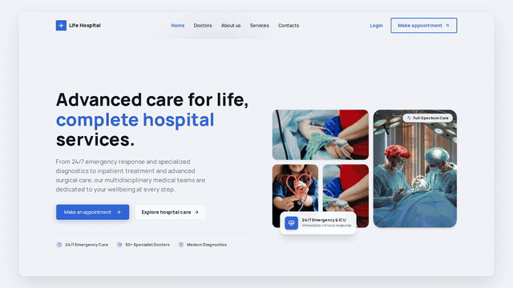

# 🏥 Life Hospital — Hospital Management System (HMS) Frontend

A modern, full-featured, enterprise-grade Hospital Management System frontend built with **Next.js 16 (App Router)**, **React 19**, **TypeScript**, and **Tailwind CSS v4**.

Designed to streamline clinical and administrative operations, Life Hospital delivers tailored workflows for **Patients**, **Doctors**, **Admins**, and the **Public**. It combines a patient-friendly storefront and appointment booking engine with secure, role-based dashboards, clinical records, interactive analytics, and doctor schedule management.

## 🎬 Demo & Links

- **Backend API:** https://hospital-management-system-back-end-pw45.onrender.com/

[](https://res.cloudinary.com/dsa8ooidh/video/upload/v1794488912/HMS_Video_with_music_w1mppj.mp4)

> Click the preview above to watch the full 1080p video with music.

## 🚀 Portals & Core Features

### 1. 🌐 Public Patient Portal & Storefront

- **Landing & Discovery**: Clean hero section, clinic highlights, specialized service showcases, and patient testimonials.
- **Doctor Directory**:
  - Search by doctor name, qualification, or department.
  - Multi-attribute filtering (specialty, consultation fee range, experience, patient ratings).
  - Real-time sorting and paginated browsing.
- **Doctor Profiles & Slot Booking**:
  - Comprehensive clinical background, specialties, degrees, experience, and consultation fees.
  - Interactive schedule picker with live available time slots.
  - Direct booking modal with automated authentication checks.
- **Company Information**: Dedicated About Us, Services, and Contact Inquiry pages with interactive feedback forms.

### 2. 🛡️ Authentication & User Lifecycle

- **Secure Authentication**: User registration, login, and token-based session management using secure cookies (`accessToken`, `refreshToken`).
- **Email Verification**: Multi-step account activation flow with OTP / token verification.
- **Account Security**: In-dashboard password updates and profile management.
- **Role Guards**: Middleware and layout-level route protection preventing unauthorized access across portal boundaries.

### 3. 🧑‍🦽 Patient Dashboard

- **Patient Overview**: Upcoming appointments summary, recent clinical notes, and quick action shortcuts.
- **My Appointments**:
  - Filterable list of appointments by status (`PENDING`, `SCHEDULED`, `COMPLETED`, `CANCELED`).
  - View full appointment metadata, doctor details, and payment information.
  - Cancellation dialog with reason tracking.
- **Prescriptions & Medical Records**:
  - Access digital prescriptions issued by attending doctors.
  - Detailed dosage instructions, prescribed medicines, and diagnosis history.
- **Reviews & Feedback**: Submit, view, edit, or delete ratings and reviews for visited doctors.
- **Personal Profile**: Update contact details, emergency contacts, address, and profile photo.

### 4. 🩺 Doctor Dashboard

- **Clinical Overview**: Today's appointment schedule, total patient count, completed visits, and pending consultations.
- **Appointment Management**:
  - Filter and inspect patient appointments.
  - Consultation status transitions and patient detail modal views.
- **Schedule & Availability Management**:
  - Configure recurring and custom doctor schedules.
  - Allocate and manage individual consultation time slots.
  - Delete or adjust unbooked schedules.
- **Digital Prescription Pad**:
  - Issue comprehensive digital prescriptions directly tied to appointments.
  - Add diagnosis summaries, instructions, dosages, and follow-up recommendations.
  - Update or revoke previously drafted prescriptions.
- **Patient Reviews**: Real-time review feed with ratings and patient comments.

### 5. ⚙️ Admin & Executive Suite

- **Comprehensive Analytics**:
  - Live metric counters (total revenue, active appointments, registered doctors, patients).
  - Monthly appointment volume charts and revenue distribution diagrams.
- **User Management**:
  - **Patients**: Browse registered patients, inspect account status, and manage profile states.
  - **Doctors**: Onboard new medical practitioners, edit doctor credentials, assign specialties, or remove profiles.
  - **Admins**: Create new administrative accounts and configure permissions.
  - **Account Controls**: Toggle active/blocked statuses and adjust account roles.
- **Specialties Management**:
  - Create, update, and manage medical departments and clinical specialties with custom icons.
- **Master Scheduling**:
  - Define global hospital schedule windows and manage doctor schedule allocations.
- **Prescriptions & Appointments Oversight**:
  - Hospital-wide monitoring of all clinical appointments, prescriptions, and financial transactions.

---

## 🛠️ Tech Stack & Architecture

| Layer                  | Technology                                                                                                       |
| :--------------------- | :--------------------------------------------------------------------------------------------------------------- |
| **Framework**          | [Next.js 16](https://nextjs.org/) (App Router, Turbopack)                                                        |
| **Library**            | [React 19](https://react.dev/)                                                                                   |
| **Language**           | [TypeScript 5](https://www.typescriptlang.org/)                                                                  |
| **Styling**            | [Tailwind CSS v4](https://tailwindcss.com/) & [tw-animate-css](https://github.com)                               |
| **UI Components**      | [shadcn/ui](https://ui.shadcn.com/), [@base-ui/react](https://base-ui.com/), [Lucide React](https://lucide.dev/) |
| **State Management**   | [TanStack React Query v5](https://tanstack.com/query/latest)                                                     |
| **Tables & Data**      | [TanStack Table v9](https://tanstack.com/table/latest) (Server-driven pagination & filtering)                    |
| **Form Management**    | [TanStack React Form](https://tanstack.com/form/latest) with [Zod](https://zod.dev/) validation                  |
| **Data Visualization** | [Recharts v3](https://recharts.org/)                                                                             |
| **Notifications**      | [Sonner](https://sonner.emilkowal.ski/)                                                                          |
| **HTTP Client**        | [Axios](https://axios-http.com/) with interceptors & cookie session handling                                     |

---

## 📂 Project Structure

```text
hms-frontend/
├── public/                 # Static assets, branding, and images
├── src/
│   ├── app/                # Next.js App Router root
│   │   ├── (authRouteGorup)/       # Login, register, email verification
│   │   ├── (commonLayout)/         # Public storefront (Home, About, Doctors, Services, Contact)
│   │   ├── (dashboardLayout)/      # Authenticated dashboards
│   │   │   ├── admin/              # Admin dashboard & management tables
│   │   │   ├── doctor/             # Doctor dashboard, appointments, prescriptions, schedules
│   │   │   ├── (patientRouteGroup)/# Patient appointments, prescriptions, reviews
│   │   │   └── (commonProtectedLayout)/ # Shared profile & security settings
│   │   ├── globals.css             # Tailwind v4 configuration & theme variables
│   │   └── layout.tsx              # Root HTML wrapper and global providers
│   ├── components/
│   │   ├── icon/           # Custom SVG icons
│   │   ├── modules/        # Domain-driven feature modules
│   │   │   ├── authModules/        # Login, registration, and OTP forms
│   │   │   ├── dashboard/          # Admin, Doctor, and Patient widgets & charts
│   │   │   └── storeFront/         # Hero, Doctor directory, filters, schedule picker
│   │   ├── shared/         # Reusable composite components (DataTable, Modal, Navbar, Footer)
│   │   └── ui/             # Atomic shadcn/ui components (Button, Dialog, Table, etc.)
│   ├── hooks/              # Custom React hooks (Data tables, filters, responsive utilities)
│   ├── providers/          # QueryClientProvider and theme providers
│   ├── service/            # API service layer (Auth, Doctor, Patient, Appointment, Schedule, etc.)
│   ├── types/              # Domain TypeScript interfaces and API schemas
│   ├── utils/              # Cookie utilities, token decoders, and query string builders
│   └── validation/         # Zod schemas for form and API payload validation
├── .env                    # Environment configuration
├── components.json         # shadcn/ui configuration
├── next.config.ts          # Next.js configuration
├── package.json            # Project manifest & dependencies
└── tsconfig.json           # TypeScript configuration
```

---

## ⚙️ Getting Started

### Prerequisites

Ensure you have the following installed on your machine:

- **Node.js**: `v20.x` or higher
- **Package Manager**: [pnpm](https://pnpm.io/) (`v9+` or `v11+`) or [Bun](https://bun.sh/)

### 1. Clone the Repository

```bash
git clone https://github.com/your-username/hms-frontend.git
cd hms-frontend
```

### 2. Environment Setup

Create a `.env` file in the root directory (or update the existing one):

```env
NEXT_API_BASE_URL=https://hospital-management-system-back-end-pw45.onrender.com
```

> **Note**: Update `NEXT_API_BASE_URL` to point to your local or deployed backend API server.

### 3. Install Dependencies

Using **pnpm**:

```bash
pnpm install
```

Or using **Bun**:

```bash
bun install
```

### 4. Run Development Server

```bash
pnpm dev
# or with Bun:
bun run dev
```

Open [http://localhost:3000](http://localhost:3000) in your browser to view the application.

---

## 📜 Available Scripts

| Command      | Description                                             |
| :----------- | :------------------------------------------------------ |
| `pnpm dev`   | Starts the development server using Turbopack           |
| `pnpm build` | Compiles the production build                           |
| `pnpm start` | Boots the compiled Next.js production server            |
| `pnpm lint`  | Runs ESLint to check for code quality and syntax issues |
| `pnpm test`  | Executes unit and integration test suites using Bun     |

---

## 🔒 Security & Best Practices

- **HTTP-Only & Secure Cookies**: Authentication tokens are safely stored and dispatched with requests.
- **Input Validation**: Strict client-side and pre-flight validation powered by Zod schemas.
- **Route Guarding**: Protected layout boundaries verify user presence and authorization roles before rendering sensitive clinical and administrative views.
- **Optimistic Updates & Cache Invalidation**: TanStack Query ensures data remains in sync without redundant round-trips.

---

## 📄 License

This project is licensed under the [MIT License](LICENSE).
